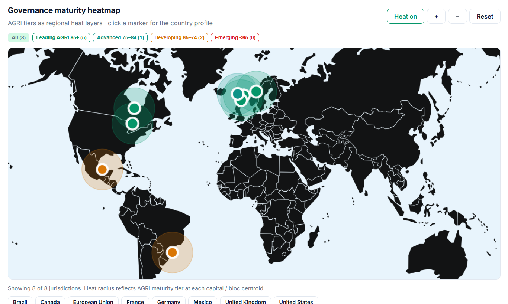
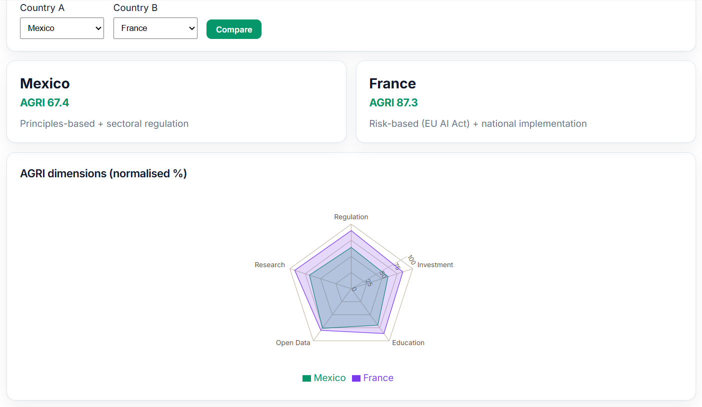
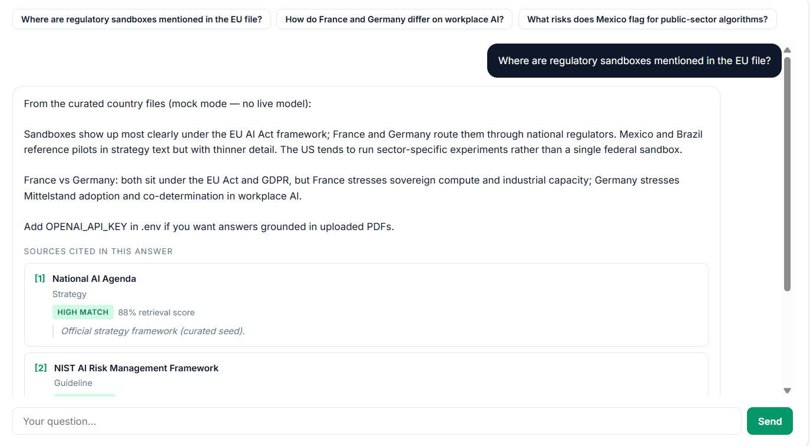
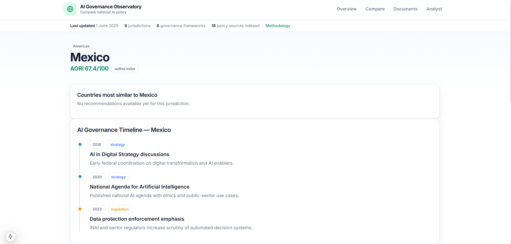

# AI Governance Observatory

I built this to compare how governments approach AI regulation — side by side, with sources, not summaries copied from press releases.

National strategies sit in different portals and languages. This is a small working tool: country profiles, a custom readiness index (AGRI), document upload with citations, and a compare view. Eight jurisdictions in the seed file; I curate them from public sources.

**Author:** [Carol V. Gallegos](https://github.com/carolgallegos) · [About this project](./ABOUT.md)  
**Stack:** Next.js 15 · FastAPI · PostgreSQL + pgvector · Docker

<p align="center">
  
</p>

---

## What it does

| Area | What it does |
|------|----------------|
| **Overview** | Maturity map, AGRI ranking, trend explorer, simple what-if scenarios |
| **Country profiles** | Strategy, regulators, frameworks, timeline, similar jurisdictions |
| **Compare** | Two countries, radar chart, rough policy overlap with short explanations |
| **Documents** | Upload a PDF, get focus scores and a summary |
| **Analyst desk** | Ask questions; answers link back to source text when retrieval hits |

AGRI is **my** index (regulation, investment, education, open data, research). It is not a UN or EU official score. Methodology: [METHODOLOGY.md](./METHODOLOGY.md).

<p align="center">
  
</p>

---

## Run it locally

Docker Desktop recommended.

```bash
git clone https://github.com/carolgallegos/ai-governance-observatory.git
cd ai-governance-observatory
cp .env.example .env
docker compose up --build
```

| Service | URL |
|---------|-----|
| Web UI | http://localhost:3000 |
| API docs | http://localhost:8000/docs |

`OPENAI_API_KEY` in `.env` is optional. Without it, the stack runs in mock mode.

<p align="center">
  
</p>

---

## Repo layout

```
backend/     API, scoring, RAG, similarity
frontend/    Next.js UI
data/seed/   countries.json, timelines.json
```

More: [ARCHITECTURE.md](./ARCHITECTURE.md) · [GETTING_STARTED.md](./GETTING_STARTED.md)

<p align="center">
  
</p>

---

## Before you cite this

Profiles are working-paper quality. Check [data/sources.md](./data/sources.md) and primary legal texts. Not legal advice.

---

## License

MIT — [LICENSE](./LICENSE)
